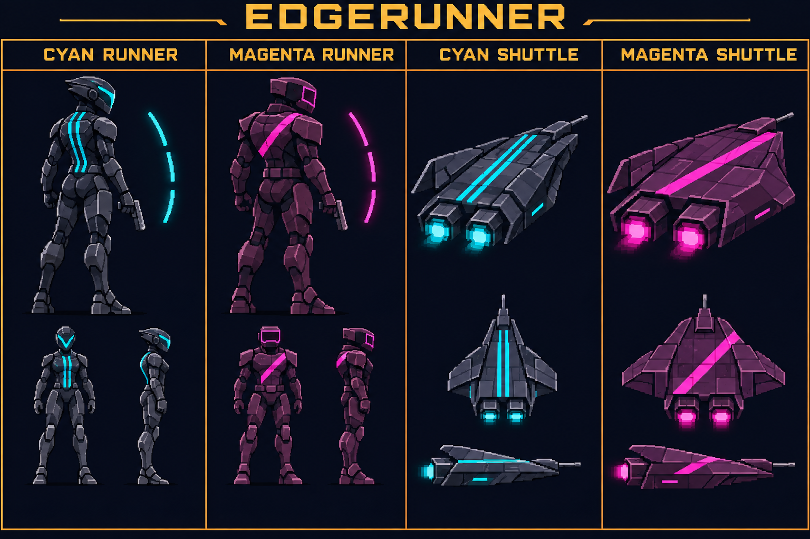

# Full course and visual design

The course follows one continuous four-lane road through the Slums, Downtown and Spaceport, then a four-lane atmospheric ascent followed by three-altitude orbital flight. Left/right steering remains; shortcuts and branching side routes have been removed. Every exit preserves the lane. Players launch and enter orbit independently.

## Course pacing

| Stage | Route | Distance / clean time | Shared coins |
| --- | --- | --- | --- |
| Slums | Basin → Market → Service gate | 220 / 22 seconds | 6 |
| Downtown | Plaza → Boulevard → Spaceport access | 240 / 24 seconds | 7 |
| Spaceport and orbit | Hangar → Atmosphere → Orbit → Palace | 275 / 27.5 seconds | 7 |

The full course takes 73.5 seconds before impacts at 10 cells per second (80% of the preceding speed). It retains the 180-second simulation limit and fifteen-second finish window. All twenty shared coins keep their positions and IDs. There are now 56 obstacles, down from 129: 42 ground props, three crossing spacecraft and eleven orbital breakables. Encounter rows are at least 16 cells / 1.6 seconds apart, including across segment boundaries. Ground rows alternate single walls and pairs, with two adjacent lanes open and openings that shift gradually. Each encounter has at most two objects and at most one unbreakable obstacle. Orbital rows leave two adjacent lanes free at every level and at least one entire altitude empty; they never require shooting. Each atmospheric crossing occupies at most one lane at a time. Gate fades and the final docking approach stay clear. Edit `scripts/build-course.js` and run `npm run build:course` to regenerate `race/full-course.json`. The course's `cruiseSpeed` is used by both the server and preview; the old prototype retains its original pacing.

### Atmospheric ascent and orbital handover

The original 210-cell flight is split evenly. `orbit-launch` covers 105 cells / 10.5 clean seconds of atmosphere (absolute progress 525–630). The 35-cell `orbit-debris` and 70-cell `orbit-dock` form another 105 cells / 10.5 seconds. Orbital obstacles have been spaced into smaller encounters, preserving both breakable satellites. The first twelve orbital cells have no hazards, allowing 1.2 seconds to settle into the altitude controls. All flight coins retain their positions and IDs; the two former first-half coins remain on the single ascent plane. The route, scoring, shield rules and final docking animation stay intact.

At launch the shuttle rises through a moving pixel-art cloudscape with extended engine plumes, city lights below, slipstream traces and a four-lane holographic corridor. Civilian spacecraft sweep across all four lanes. These are solid traffic obstacles: shots are blocked, contact spends 25 flight shield HP, and they never attack, target, drop items or behave as enemies. Three crossings remain at distances 16, 42 and 70. Each hull reverses outside the lane edges over a 4.8–6.0-second cycle. `public/js/race-motion.js` supplies the same continuous motion to the engine, preview and renderer. Collisions and projectile hits sample the exact row-crossing time; rendering uses the snapshot race clock with at most 50 ms extrapolation. Reconnection does not restart traffic.

Altitude stays locked at MID during ascent, with W/S (owner) and Up/Down (guest) rejected by the server and disabled in both interfaces. The final 35 cells have no ascent encounters. Across the last 18 cells (1.8 seconds), clouds thin, the starfield and Earth's limb emerge, and LOW/HIGH lane grids spread vertically away from the existing MID plane. Upcoming orbital hazards are visible ahead during the reveal. The four lane centers and player position remain aligned throughout. A role-specific banner explains that altitude controls unlock at orbit entry. At progress 630, the server emits `orbitEntered`, enables altitude input and retains the same lane, MID altitude, shield, ammunition and longitudinal position. The atmospheric backdrop blends into the original orbit artwork over the next eight cells; there is no blackout, pause, teleport or shared wait at this boundary. Each player experiences this sequence at their own position.

Movement uses smaller collision steps within each 50 ms simulation tick so normal running and the 2x practice boost check every crossed object row. Projectile speed, network updates and input timing retain their existing rates. Regression checks finish without damage, firing or cheats from both seats, making at most two steering inputs per second and looking fourteen cells ahead. Twenty-four delayed starts per seat vary arrival times across the moving traffic cycles; the other player is frozen so it cannot clear obstacles. Map rebuilds apply to newly created matches; refresh and create a new room to use the updated layout. Engine changes also require a server restart.

## Road, collectibles and obstacles

The shared Canvas renderer places the ground race inside a moving city street. A full-width ground plane, sidewalks, side streets and low kerbs meet the playable road at the same perspective. Raised continuous guardrails have been removed. Eight detailed building facades are mapped onto walls with end faces and roofs, so nearby architecture grows and passes the camera while the original paintings supply only the distant skyline. Slums shopfronts have rust, awnings, amber windows and overhead wires; Downtown has clean white-and-glass buildings, cyan lighting, planters and occasional glass skybridges. The spaceport is an enclosed, clean spacecraft hangar inspired by Star Wars interiors: white and gray bulkheads, recessed graphite vents, observation windows, illuminated ceiling ribs and deck-edge light strips. It uses its own aerospace wall atlas rather than Slums facades. Streetlamps, projecting signs, pavement joints and building shadows move with course distance. All roadside scenery is decorative and outside the four playable lanes.

The street extends 160 cells into the distance, with fog on distant buildings; gameplay objects retain their existing 45-cell view range. Buildings and road details use absolute course distance, preserving their placement across same-stage segment boundaries. Ground and flight rendering extrapolate observed movement for at most one 50 ms simulation tick between snapshots, keeping road, scenery, hazards and rivals on the same camera. It stops when paused, stunned, disconnected or finished, and never changes the authoritative snapshot. Scenery generation and facade sampling use Canvas 2D with no new dependencies or game engine.

Downtown uses cooler light; the Slums uses amber; the Spaceport uses violet. The retained orbital half uses its original space backdrop and 160-pixel altitude spacing, with cyan LOW, amber MID and violet HIGH lane guides. The current corridor is shaded. Obstacles have matching level rings and nearby LOW/MID/HIGH plus lane badges; ON COURSE marks hazards in the player's exact lane and altitude. Distant hazards keep rings without text to reduce clutter.

### Gates, area transitions and docking

`gate` metadata in the course generator defines four actual rendered gateways: the rusty Slums security checkpoint, white/cyan Downtown transit airlock, clean spaceport launch blast doors and ivory/gold Crystal Palace docking hangar. Doors slide apart as the first runner approaches from 24 to 6 cells away and remain open for the trailing player. Frames, machinery, lit interior passages and ground contact replace the former border lines. Same-area road sections continue seamlessly without a gate or blackout.

At an area or launch gate, the viewport fades to black over the last 1.6 cells, stays black through the next area's first 1.4 cells, then reveals the scene by 3.6 cells. These intervals contain no hazards or pickups. Each browser derives the effect from its own runner's position; the simulation keeps moving normally. No shared teleport, waiting barrier or position reset is introduced, so a leader can be in Downtown while a trailing runner remains in the Slums. Transitions preserve course distance and the existing score/timer rules. The launch blackout also covers the runner-to-shuttle change.

Multiplayer rooms read the generated course at match creation, so subsequent rebuilds affect new rooms without altering an ongoing race. For rooms made by an older server that sends no `gate` metadata, the renderer recovers the known full course's gate presentation from its existing stage/mode boundaries and final endpoint. Explicit metadata takes priority, and unrelated course IDs are left alone. HTML entry points version their renderer scripts; refresh an already-open tab after a visual update.

At the final hangar, the camera stops eight cells before the finish while the shuttle continues into the open bay. After the server records the finish, the local shuttle accelerates deeper into the hangar, shrinks and disappears over 1.6 seconds. A broad station hull, landing apron and gold frame surround the bay. The 2.2-second arrival presentation completes before the preview overlay or multiplayer results panel is revealed. An early finisher sees a waiting message while the other player continues; DNF results have no docking animation. Animation timing is local and never delays the server's finish time, first-finisher window or rankings.

Ground lanes use cached, seeded pixel materials rather than smooth pavement: aged brown asphalt with rust blooms, oxidised bolted repair plates, branching cracks, crumbling tar seams and damp spots in the Slums; clean white ceramic-composite panels with precise recessed joints, cyan service inlays and flush access ports Downtown; bolted, treaded steel panels in the hangar. Downtown uses dark lane markings for contrast, a lighter distance tint and no tire-wear overlay. Recessed drain grates and service covers provide scale. The material palette follows each map's artwork, with restrained industrial wear informed by [Cyberpunk 2077 street imagery](https://www.nexusmods.com/cyberpunk2077/mods/17760?file_id=107109). These are original Canvas-generated surfaces, with no downloaded game textures or added dependencies. Perspective scanlines sample course-relative coordinates so texture details move with the road and stay continuous across same-stage segment boundaries. Distant texture samples are filtered to reduce shimmering.

Ground props have individually measured atlas pivots at their physical bases. Crates and cargo sit on their base centres; pipes stand on the lower flange; glass, walls and hovercars use their own support footprints. Road-plane grime, cast shadows and tight contact shadows are drawn beneath the scene's entities. The low hovercar underglow stays inside its footprint. Orbital objects retain their floating presentation. This changes visual placement only; obstacle lanes, distances and collision rules are unchanged.

Rival visibility uses the absolute longitudinal separation on a connected route. Both seats fade from 9 to 12 cells and hide at or beyond 12, including across same-stage segment boundaries. A rival behind the chase camera has a rear indicator within that same range. Players in different stages or movement modes do not appear in each other's world view. Score and progress HUDs remain available.

Coins have a metallic gradient, embossed center, glowing rim and slow rotation. Crystal shards use translucent facets. Obstacles use the transparent `obstacles.png` sprite atlas, matching the original Gadgets and Obstacles concept board: cracked wood and metal corners, framed fractured glass, rusty elbow pipes, white armored hovercars, cracked cargo containers, concrete hazard walls and torn solar panels. Derelict satellites retain their damaged solar wings and cylindrical housing, with no active eye or weapon. Orbital props drift gently. Canvas draws the atlas with nearest-neighbor sampling and perspective scaling.

Gadgets and enemies are removed from the current scope due to time constraints. The two satellites in the retained orbital half are ordinary breakable terrain: one shot destroys them for both players; contact breaks them and costs 10 shield HP, like other orbital debris. They do not target, fire, lock on, or drop modules. Atmospheric traffic is also non-combatant and follows fixed crossing paths.

Lasers use their owner's cyan or magenta color, a restrained glow and a bright core. Compact 0.85-cell bolts travel at 45 cells per second, with perspective aligned to the runner's right-hand gun tip or shuttle's nose cannon. A brief muzzle flash follows the sprite's bob. Bolts fade over the final five cells of the 45-cell visible road. A 72-cell server range lets an unobstructed shot reach that horizon while its owner runs. Obstacles intercept shots; stage and ground/flight boundaries stop them. Same-stage segment transitions preserve a visible laser ahead of the player.

## Basic guns and shields

| System | Implemented behavior |
| --- | --- |
| Ground pistol | Three rounds. One shot per press with a 200 ms minimum interval. Refill one round per second from the first spent round. Further shots do not restart that timer. |
| Shuttle gun | Available at launch. Uses the same three-round magazine and recharge as the pistol. This basic kit replaces the earlier optional turret installation for this build. |
| Projectile | Straight ahead at 45 cells per second, 72-cell range. Follows the firing lane through same-stage/same-mode exits. Stops at a stage or launch boundary. Ignores coins and the rival. |
| Terrain | One shot destroys a crate, glass pane or orbital debris for both players. Solid obstacles block shots. Shooting resolves before runner contacts in the same tick. |
| Ground shield | Three gauges. A hit spends one; refill one every two seconds while nonzero. Crates break at full speed with an intact shield. Solid obstacles slow and phase for 0.5 seconds. Last-gauge or zero-shield hits stun for 1.5 seconds, followed by one second of recovery immunity. Broken shields do not refill. |
| Orbital shield | Starts at 100 HP. Debris costs 10 HP and breaks. Solid hulls cost 25 HP and cause the brief slow/phase if the shield survives. At zero, pause movement and controls for 2.5 seconds, restore to 100, then grant one second of immunity. No ordinary passive refill. |

The 200 ms interval, 72-cell range, starter shuttle gun and 25 HP hull impact are explicit playtest choices. Basic shots never hurt the rival. Phase suppresses shooting and pickups. Already-fired shots continue after disconnect; pending controls clear and the runner freezes. Reconnection includes active projectiles and removed objects.

## Player and spaceship art

| Identity | Runner | Shuttle |
| --- | --- | --- |
| Cyan | Graphite armor, swept slim helmet, two parallel cyan stripes down the back, compact right-hand pistol. | Narrow slate wedge, two cyan hull stripes, twin cyan exhausts, fixed forward cannon. |
| Magenta | Plum armor, squared helmet and shoulders, one diagonal magenta stripe, same basic pistol. | Broader plum wedge, diagonal magenta marking, twin magenta exhausts, same basic forward cannon. |

Silhouette and stripe differences reinforce color identification. Differences are cosmetic: movement, collision cells and weapons are identical. Ship noses point up-screen, exhausts behind. Three segmented shield arcs surround the models. In flight, arcs approximate HP thirds; the numeric HUD remains exact.

The transparent atlases have two columns and two rows: cyan runner, magenta runner, cyan shuttle, magenta shuttle in reading order. Ground rendering uses the top row of `racers-forward.png`, with both right-hand pistols aimed up-screen along the running direction. The muzzle anchor is (21, -151) in the 145×165 drawing coordinates. Flight retains the bottom row of the original `racers.png` so shuttle artwork stays unchanged. Draw with nearest-neighbor sampling. The preview uses one pose per entity, motion bobbing and shield overlays. The design board's alternate views are reference art, not an animation atlas.

| File under `public/assets/` | Purpose |
| --- | --- |
| `slums.png` | Basin and scaffold environment key art |
| `downtown.png` | Boulevard and terrace environment key art |
| `spaceport.png` | Hangar-to-Palace environment, cropped during flight |
| `atmosphere.png` | Cloudscape and distant city during atmospheric ascent |
| `atmosphere-traffic.png` | Transparent 2×2 atlas of four civilian crossing spacecraft |
| `racers.png` | Transparent playable entity atlas |
| `racers-forward.png` | Edited runner poses with forward-pointing pistols; only the top row is used |
| `character-design.png` | Character and ship model reference |
| `obstacles.png` | Transparent 4×2 prop atlas: crate, glass, pipe, hovercar / cargo, wall, solar debris, derelict satellite |
| `city-facades.png` | Opaque 4×2 architectural atlas: four worn Slums facades above four clean Downtown facades, projected onto moving building walls |
| `spaceport-architecture.png` | Opaque 4×2 atlas: four clean spacecraft wall modules above four pairs of sliding gate doors, also sampled for jambs, passage walls and docking hull panels |

All eleven assets were generated with the built-in image tool. [Generation prompts](art-prompts.json). The obstacle atlas uses the original Gadgets and Obstacles and Runners and NPCs concept boards as visual references, repurposing the satellite as inert wreckage. Ground paintings supply the distant city skylines; the enclosed spaceport uses a projected ceiling and its own wall textures. Nearby buildings and street details are projected from world coordinates. Actual lanes, gates, coins and obstacles are drawn from course data. The local preview uses a scripted rival. The shared room adapter defaults to the same full course for the teammate's multiplayer Canvas client.

## Playtest and integration

Run `npm run preview`, then open `http://127.0.0.1:8010`. Start point selects the full course, an individual stage, atmosphere followed by orbit, or orbit alone. Restart creates fresh coins, gun, shield and cheat state. Preview controls: A/D steer; W/S changes altitude; F or click fires. Multiplayer assigns WASD/F to the owner and arrows/Enter to the guest. L enables immunity; hold Space for 1.5× speed in the focused player’s window. C retains the old practice-only cheat until L is enabled. There are no gadget pickups or actions.

The Socket.IO input envelope is `{ matchId, action, controlSeat? }`; controlSeat 0 is the owner and 1 the guest. In explicitly enabled same-device test rooms, movement and firing may be relayed from either valid authenticated socket to the other connected seat. Each browser retains its own view. Other rooms reject cross-seat input. L and Space always target the signed-in player. Added actions: `fire`, `up`, `down`. Player fields now include `mode`, `altitude`, `maxShield`, `ammo`, `maxAmmo`, `ammoRefillMs`. Active shots are in `snapshot.projectiles`; new tick events are `shotFired`, `shotHit`, `launched`, `orbitEntered`, `stageChanged`. New cheat inputs are `enableImmunity`, `boostStart` and `boostEnd`; snapshots carry `immunityActive` and `boostActive`. Immunity blocks all obstacle damage, slows and stuns, preserves pickups, clears current penalties, and lasts until a new race. Hold boost while immune for 1.5× normal speed, with release/blur/disconnect clearing the boost; it does not stack with the legacy 2× cheat. Results mark `usedCheat`. Ground altitude is 0; atmospheric altitude is locked at 1; orbital entry is 1. Missing flight-object altitude means middle.

Run `npm test` for a continuous lane-preserving route, travel time, twenty-coin inventory, gun collisions, recharge, independent launches, orbital recovery and existing session/engine behavior. The original prototype is retained for regression tests.

The teammate lobby has pre-existing leave-room delivery and finished-match reconnect gaps identified during repository review. This map/art pass does not change its lifecycle. The multiplayer and solo preview share the same full-course renderer.
