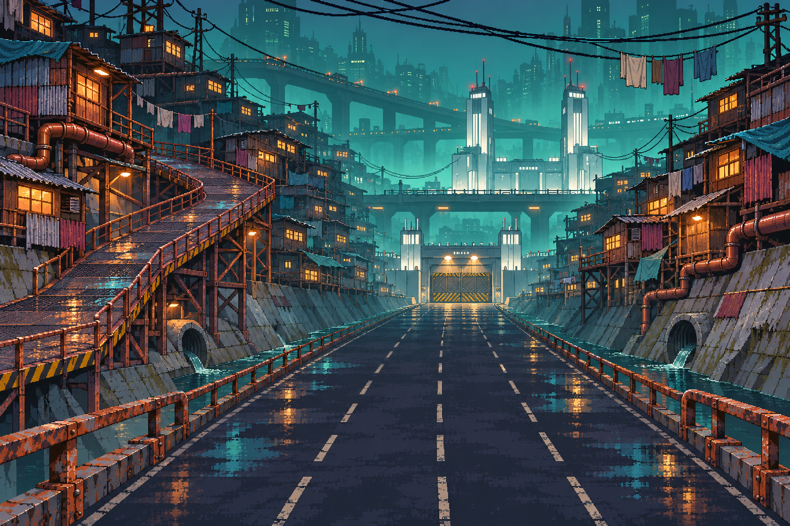
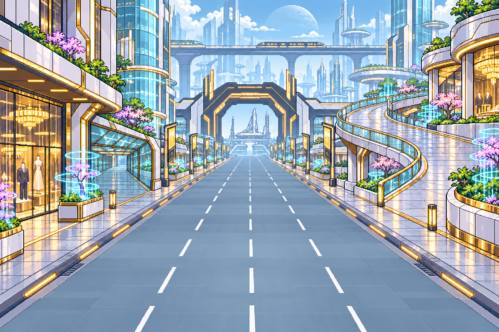
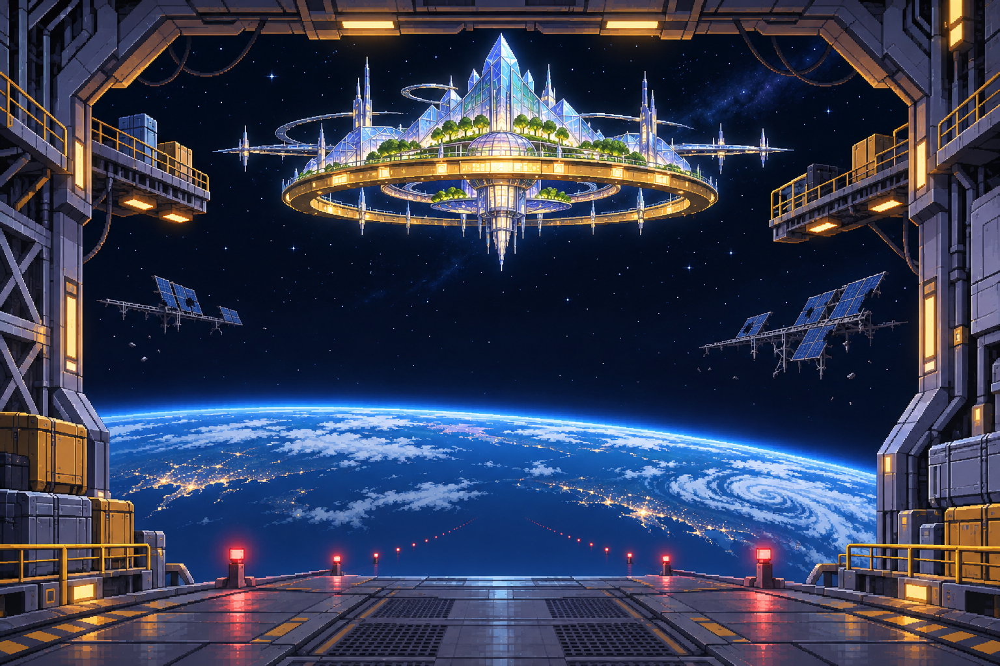

# Edgerunner maps and character design

The course runs continuously from the drainage basin to the Crystal Palace. Players share coins and destroyed terrain, choose their own routes, and launch independently. This build uses basic guns and shields. Map placements are implemented in `race/full-course.json`; edit `scripts/build-course.js` and run `npm run build:course` to change them.

## Course pacing

Cruise speed is five cells per second. A cell is one lane wide and one runner length forward. Main ground routes have four lanes; ground branches have three. All flight routes have four horizontal lanes and three altitudes. Lane numbers below are 1–4; JSON uses 0–3. Flight altitude is 0 low, 1 middle and 2 high.

| Stage | Main distance and time | Alternative routes | Shared coins |
| --- | --- | --- | --- |
| The Slums | 220 cells, 44 s | Scaffold: 210 cells, 42 s | 6 Scrap Tokens |
| Downtown | 240 cells, 48 s | Service: 220 cells, 44 s; terraces: 255 cells, 51 s | 7 City Credits |
| Spaceport and orbit | 275 cells, 55 s | Outer drift: 290 cells, 58 s | 7 Crystal Shards |

The main route takes 147 seconds (2:27); the shortest and longest combinations take 141 and 153 seconds (2:21–2:33) before impacts. Even the longest clean route leaves 27 seconds under the three-minute cap: fifteen for the rival's finish window and twelve for collision delays. The progress meter uses 0–735 units, with parallel routes mapped between the same entry and exit. Twenty coins exist across all branches; an individual route passes only a subset. Encounters are distributed across the longer routes, with additional crates and hazards between the existing collection decisions.

First finish awards six points and starts a fifteen-second window for the rival. Both players get the bonus on a same-tick finish. The match cap remains three minutes. Finishers rank ahead of unfinished runners; coins plus finish bonus determine points. Finish time breaks a points tie between finishers, and progress breaks a points tie between unfinished runners.

## The Slums



The start is deep inside a drainage basin. Patched shelters, laundry and amber windows crowd the walls; exposed pipes and elevated roads cut through teal haze. A pale security gate anchors the horizon. The channel rewards collection and steering; the left scaffold ramp exchanges coins for time.

```text
Drainage basin, 50 cells
  lane 1    → Scaffold shortcut, 100 cells, 3 lanes ─┐
  lanes 2–4 → Market channel, 110 cells, 4 lanes ────┴→ Service gate, 60 → Downtown
```

| Segment | Progress | Encounter sequence |
| --- | --- | --- |
| Drainage basin | 0–50 | Tokens at rows 14 and 25 teach lane changes. A crate at row 36 teaches shooting. A pipe at row 44 teaches avoidance. The branch sign appears within 35 cells of the gate. |
| Market channel | 50–160 | Three tokens at rows 22, 52 and 86 draw the player across lanes 3, 2 and 4. Three crates and three pipes are spread through the channel without closing all lanes. |
| Scaffold shortcut | 50–160 | Enter in the middle of three lanes. Shoot the crate at row 24, move past a pipe, collect the row-58 token, then steer through the final hazards. Saves two seconds. |
| Service gate climb | 160–220 | Scaffold merges into lane 1; channel preserves its lanes. Three staggered pipes and two crates precede the gate. Entering Downtown preserves regular ammo and shield. |

Palette: midnight navy `#0b1523`, weathered copper `#e9a56a`, amber `#f4ad62`, subdued teal haze. Copper coins have square dark centers. Braced crates contrast with amber-edged solid pipes. Busy architectural detail stays outside the playable lane surface.

The playable scaffold has moving copper rail posts and crossbeams along its edges, so taking the shortcut changes the foreground as well as lane count. A route guide names the destinations before the gate and highlights the destination selected by the current lane.

## Downtown



The gate opens onto white ceramic streets, glass towers, elevated trains and planted terraces. The skyline opens up after the basin. A black-and-gold spaceport arch is the next landmark. The middle boulevard is the standard route; a left glass corridor saves time, while the right terraces offer a longer, less compressed collection route.

```text
Transit plaza, 45 cells
  lane 1    → Service corridor, 105 cells, 3 lanes ─┐
  lanes 2–3 → Glass boulevard, 125 cells, 4 lanes ───┼→ Spaceport approach, 70 → Hangar
  lane 4    → Garden terraces, 140 cells, 3 lanes ───┘
```

| Segment | Progress | Encounter sequence |
| --- | --- | --- |
| Transit plaza | 220–265 | A stationary car at row 21 introduces the solid obstacle silhouette; a pane at row 30 provides a shooting opportunity. Choose an outer branch or keep a middle lane. |
| Glass boulevard | 265–390 | Three credits at rows 29, 63 and 101 in lanes 2, 3 and 4. Four stationary cars alternate with three breakable panes. |
| Service corridor | 265–390 | Three panes span row 21: shoot the pane in your lane or spend one gauge. A wall at row 46 and one credit at row 61 follow. Later panes and another wall extend the steering challenge. All lanes merge into lane 1. Saves four seconds. |
| Garden terraces | 265–390 | Credits at rows 30, 66 and 107, in lanes 1, 3 and 2. Solid planters create broad slalom turns with two panes between them. Both this route and the boulevard hold three credits; terraces cost three more seconds. Merge into lane 4. |
| Spaceport approach | 390–460 | Seventy shared cells give the rivals time to see each other after the merge. Three cars and two panes precede the access hatch. Ground equipment carries through. |

Palette: ceramic `#e3e8e9`, cyan glass `#a6ecf5`, gold `#ffda73`, slate road `#344858`. Glass is translucent with white framing and a crack. Cars have dark windows and rear lamps. Holographic gardens sit off the collision lanes. Gold credits retain a high-contrast center.

Service-corridor edges use glass posts; the terraces use ceramic planters and flowering shrubs. Roadside scenery is decorative. Solid planters in the track are separate objects with lane positions and collisions.

## Spaceport and orbit



The third map includes the ground hangar, launch, two flight routes and docking. Steel cargo gantries frame the exit. Earth's curve replaces the road in flight and the faceted Crystal Palace stays ahead. Each runner launches at their own time; one can be flying while the rival is still on foot.

```text
Hangar break-in, 65 → Launch corridor, 30
  lane 1    → Outer drift, 125 ───┐
  lanes 2–4 → Debris corridor, 110 ┴→ Palace approach, 70 → Finish
```

| Segment | Progress | Encounter sequence |
| --- | --- | --- |
| Hangar break-in | 460–525 | Shards at rows 20 and 42, two cargo crates and two solid cargo walls. Final thirteen cells are clear. Every lane has an assigned shuttle. |
| Launch corridor | 525–555 | Start flight at middle altitude, with 100 shield HP and a full basic gun. A shard at row 21, lane 3, high altitude gives 4.2 seconds to learn altitude control. No hazards. |
| Debris corridor | 555–665 | Two shards at low and high altitudes, six breakable debris pieces, three solid satellite hulls. Every object occupies a single lane/altitude cell. Hulls are inert obstacles. |
| Outer drift | 555–665 | Three debris pieces and one high shard. A quieter four-lane route that costs three seconds. Lane and altitude persist through the merge. |
| Palace approach | 665–735 | One middle-altitude shard, two debris pieces, one hull. Final twenty-eight cells are clear. All lanes and altitudes cross the same finish plane. |

Palette: steel `#526a85`, space `#050c1d`, shards `#bbf4ff`, amber door lamps and a gold docking ring. The hangar uses the full environment painting; the flight camera crops toward Earth and the station. Faint low/middle/high guides and nearby object labels support depth reading. They are interface marks rather than physical rails.

Hangar beacons pass along the runway edge. In flight, breakable debris tumbles, solid satellite hulls retain their wide panel silhouette, and Crystal Shards use a faceted diamond shape. These cues distinguish shootable terrain from solid hazards.

## Basic guns and shields

| System | Implemented behavior |
| --- | --- |
| Ground pistol | Three rounds. One shot per press with a 200 ms minimum interval. Refill one round per second from the first spent round. Further shots do not restart that timer. |
| Shuttle gun | Available at launch. Uses the same three-round magazine and recharge as the pistol. This basic kit replaces the earlier optional turret installation for this build. |
| Projectile | Straight ahead at three times cruise speed, twelve-cell range. Follows the firing lane through same-stage/same-mode exits. Stops at a stage or launch boundary. Ignores coins and the rival. |
| Terrain | One shot destroys a crate, glass pane or orbital debris for both players. Solid obstacles block shots. Shooting resolves before runner contacts in the same tick. |
| Ground shield | Three gauges. A hit spends one; refill one every two seconds while nonzero. Crates break at full speed with an intact shield. Solid obstacles slow and phase for 0.5 seconds. Last-gauge or zero-shield hits stun for 1.5 seconds, followed by one second of recovery immunity. Broken shields do not refill. |
| Orbital shield | Starts at 100 HP. Debris costs 10 HP and breaks. Solid hulls cost 25 HP and cause the brief slow/phase if the shield survives. At zero, pause movement and controls for 2.5 seconds, restore to 100, then grant one second of immunity. No ordinary passive refill. |

The 200 ms interval, twelve-cell range, starter shuttle gun and 25 HP hull impact are explicit playtest choices. Basic shots never hurt the rival. Phase suppresses shooting and pickups. Already-fired shots continue after disconnect; pending controls clear and the runner freezes. Reconnection includes active projectiles and removed objects.

## Player and spaceship art


| Identity | Runner | Shuttle |
| --- | --- | --- |
| Cyan | Graphite armor, swept slim helmet, two parallel cyan stripes down the back, compact right-hand pistol. | Narrow slate wedge, two cyan hull stripes, twin cyan exhausts, fixed forward cannon. |
| Magenta | Plum armor, squared helmet and shoulders, one diagonal magenta stripe, same basic pistol. | Broader plum wedge, diagonal magenta marking, twin magenta exhausts, same basic forward cannon. |

Silhouette and stripe differences reinforce color identification. Differences are cosmetic: movement, collision cells and weapons are identical. Ship noses point up-screen, exhausts behind. Three segmented shield arcs surround the models. In flight, arcs approximate HP thirds; the numeric HUD remains exact.

The transparent `racers.png` atlas has two columns and two rows: cyan runner, magenta runner, cyan shuttle, magenta shuttle in reading order. Draw with nearest-neighbor sampling. The preview uses one pose per entity, motion bobbing and shield overlays. The design board's alternate views are reference art, not an animation atlas. A future animation pass can add run, bank, recoil and impact frames while preserving identity and anchors.

| File under `public/assets/` | Purpose |
| --- | --- |
| `slums.png` | Basin and scaffold environment key art |
| `downtown.png` | Boulevard and terrace environment key art |
| `spaceport.png` | Hangar-to-Palace environment, cropped during flight |
| `racers.png` | Transparent playable entity atlas |
| `character-design.png` | Character and ship model reference |

All five assets were generated with the built-in image tool. [Exact generation prompts](art-prompts.json). Backgrounds establish the environment; actual lanes, gates, coins and obstacles are drawn from course data. The local preview uses a scripted rival. The shared room adapter defaults to the same full course for the teammate's multiplayer Canvas client.

## Playtest and integration

Run `npm run preview`, then open `http://127.0.0.1:8010`. Start point selects the full course or an individual stage. Restart creates fresh coins, gun, shield and cheat state. Controls: A/D or Left/Right to steer; W/S or Up/Down for altitude; click or Space to fire; C for practice cheat. There are no gadget pickups or actions.

The Socket.IO envelope remains `{ matchId, action }`. Added actions: `fire`, `up`, `down`. Player fields now include `mode`, `altitude`, `maxShield`, `ammo`, `maxAmmo`, `ammoRefillMs`. Active shots are in `snapshot.projectiles`; new tick events are `shotFired`, `shotHit`, `launched`, `stageChanged`. Ground altitude is 0; orbital entry is 1. Missing flight-object altitude means middle.

Run `npm test` for route reachability, all twelve fork combinations, travel times, twenty-coin inventory, gun collisions, recharge, independent launches, orbital recovery and existing session/engine behavior. The original prototype is retained for regression tests.

The teammate lobby has pre-existing leave-room delivery and finished-match reconnect gaps identified during repository review. This map/art pass does not change its lifecycle. Normal home/lobby pages remain placeholders; the preview provides a separate playable review surface.
